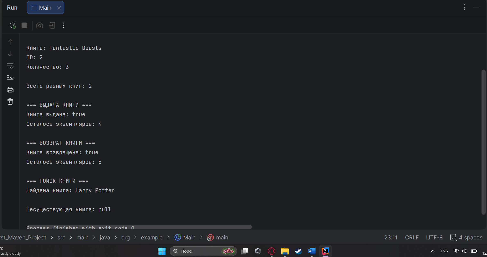

# Library

A simple console-based library management system written in Java.
It allows adding books, borrowing and returning them, and tracking
available copies through a service layer covered by unit tests.

## Features

- Add books with validation (title, author, year, number of copies)
- Borrow and return books for registered readers
- Look up a book by its ID
- Count total books in the library

## Tech Stack

- Java 26
- Maven (build and dependency management)
- JUnit 5 (unit testing, ~70%+ test coverage of the service layer)

## Project Structure

```
src/main/java/org/example/   - main application code
src/test/java/org/example/   - unit tests
```

## How to Run

1. Open the project folder in IntelliJ IDEA (`File → Open...`).
2. Wait for Maven to finish importing dependencies.
3. Open `src/main/java/org/example/Main.java`.
4. Run it (click the green ▶ icon next to `main`, or press `Shift+F10`).

## Run Tests

Right-click the `src/test/java/org/example` folder → `Run 'Tests in...'`,
or run from the terminal:

```bash
mvn test
```

## Screenshot



## License

This project is licensed under the MIT License — see the [LICENSE](LICENSE) file for details.